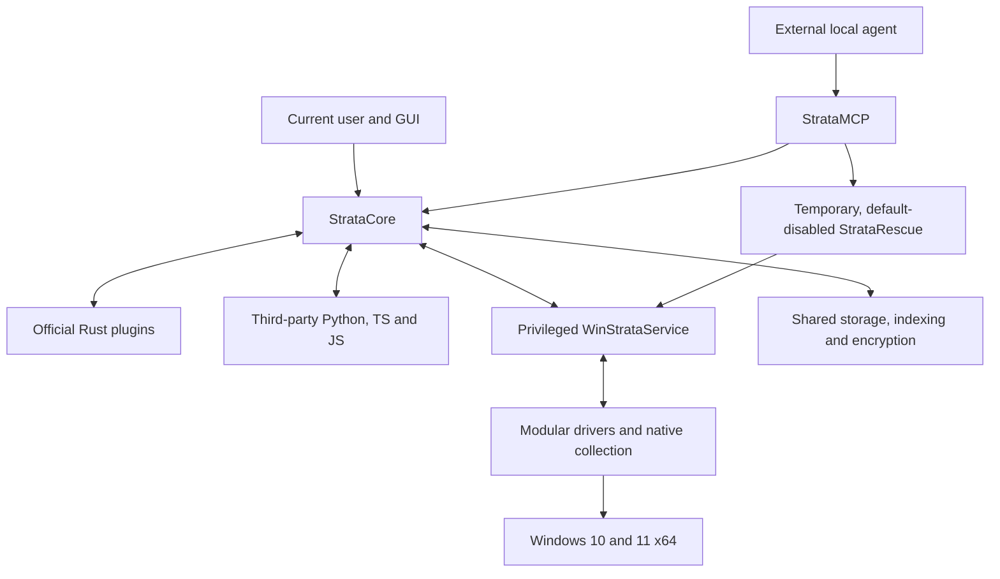

# System architecture and engineering layout

[简体中文](../zh-CN/architecture/SYSTEM.md) · [Index](../INDEX.md)

## Runtime architecture

Core remains installed and supplies GUI hosting, market and plugin lifecycle, capabilities, isolation, events and IPC, shared collection, storage, indexing, configuration, encryption, scheduling, budget floors, errors, updates, and settings. Business capability belongs to plugins. Core stays stable with all plugins disabled and starts dedicated collection and runtimes on demand.

The GUI and Core use ordinary user privileges. The controlled service performs necessary privileged work. Drivers run in kernel mode. Versioned IPC checks identity, current-user ownership, parameters, and capabilities and records audits. Plugins and scripts use capability APIs. Standard plugins receive neither direct driver access nor service privileges. Rescue has a separate explicit contract. The current service, IPC and driver subscription manager are specified in [Service and kernel control](SERVICE-KERNEL.md).

The active GUI is replaceable under [AG-64](../../AGENTS.md#ag-64). Core does not own its visual system. The official default GUI stays installed as the default and the recovery interface. Replacing the GUI does not stop collection, restart unrelated services, or discard stored data. The diagram above remains the privilege split. It is not a choice of GUI toolkit. Tauri, React, TypeScript, and Vite stay unapproved candidates for the official shell. They are not an approved design for third-party replacement.

### Collection and drivers

Prefer supported ETW, WFP, PDH, WMI/CIM, Windows API, USN Journal and Event Log, with official minifilter and registry, process, thread and module callbacks where needed. Get implementation and external project approval after practical research. The current process, thread and module sample uses procfs or Toolhelp and the Service Control Manager. It is specified in [Process sources](PROCESS.md) and does not load `strata-proc`. Plan 011 observes interfaces and TCP/UDP endpoints from user mode and keeps raw packets in memory unless a qualifying tag names one packet. See [Network sources](NETWORK-SOURCES.md). It does not load `strata-net.sys`.

Independently build, version, manage, load on demand, and unload drivers. Candidate names are `strata-fs.sys`, `strata-reg.sys`, `strata-proc.sys`, and `strata-net.sys`. Validate module boundaries and subscription reference counts. Contain failed loads. Limit kernel work to collection and transport and manage IRQL, locks, memory, buffers, and callback time. Preserve signing, Secure Boot and HVCI and use supported interfaces. Verify real Windows loading, unloading, fault recovery, stability, and sustained operation.

Plan 009 observes one chosen directory and one HKCU subkey with user-mode `ReadDirectoryChangesW` and `RegNotifyChangeKeyValue`. That collection is specified in [File and registry collection](FILE-REGISTRY.md). It does not load `strata-fs.sys` or `strata-reg.sys`. Plan 019 watches up to four current-user and local-machine keys in the plugin host. That watch is specified in [Registry plugin](REGISTRY.md). It does not load `strata-reg.sys` and does not replace the plan 009 watch.

### Events, scheduling, and shared state

- Version event types and protocol. Carry source, stable device/user/process identity, timestamp, order, precision, attribution evidence, and completeness. Trace missing sequences and verify PID reuse, restart, clock changes and cross-source alignment.
- Share collection, bound buffers and waits, batch, minimize copying, use backpressure and deduplicate. Mark intentional filters, sampling, unexpected loss, pause and failures distinctly.
- Core schedules by priority, supports cancellation and timeouts, and enforces budgets. Validate specialized high-throughput paths. Keep the GUI thread responsive.
- Share object IDs, references, and events through declared capabilities and versioned services. Validate required and optional dependencies, cycles, disablement, degradation, recovery, and independent updates. Access other modules through contracts.
- Core indexes global search, related queries, and objects. Plugins provide business views. Trace source records, computations, confidence and coverage.

See the [v1 protocol](PROTOCOLS.md) for event keys, object references, gap markers, diagnostics and compatibility rules. Bounded scheduling, the event bus and the minimum queue protection are the [Core runtime](CORE-RUNTIME.md).

### Build constraints

Rust Core, web frontend, mixed runtimes, Windows artifacts, and Linux/Windows development are required. Tauri, React, TypeScript, Vite, Cargo and pnpm workspaces, SQLite, native Windows Rust bindings, async runtimes, and LLVM/LLD are candidates. Get approval before fixing packages or versions.

Build full Windows x64 artifacts, including drivers, service, GUI, and development outputs, on native Linux without delegating compilation to Windows. Verify cross-linking, INF/CAT, signing and toolchain feasibility. Real Windows separately verifies loading, HVCI, and GUI. Start with official research and actual proofs of concept, and report blockers for approval before changing constraints.

The current developer checks dependencies, build, test and diagnosis in their available environment. Preserve both build capabilities and fix confirmed cross-platform faults. Record unrun checks. Windows runtime needs separate evidence. Cloud VMs and dual verification are optional per PR. Target-platform implementation status, build/packaging isolation, and mandatory pre-task reading follow [AG-65](../../AGENTS.md#ag-65) and [PLATFORM_ISOLATION.md](../standards/PLATFORM_ISOLATION.md).

## Repository layout proposal

| Path | Responsibility |
|---|---|
| Root manifests and lockfiles | Cargo and pnpm workspace dependencies, versions and resolution |
| `apps/desktop`, `packages` | Desktop host, shared UI and types |
| `core`, `protocols` | Shared services, IPC, events, plugin contracts and versions |
| `kernel`, `services` | Modular Windows drivers and privileged service |
| `plugins`, `sdk`, `runtimes` | Official plugins, Python/TypeScript/JavaScript SDKs and isolated runtimes |
| `toolchains`, `scripts` | Central toolchain resolution and approved entry points |
| `tests`, `benchmarks` | Integrated regression and repeatable measurement |
| `docs`, `.github` | Governing documents, review and CI |

See the [development toolchain](DEVELOPMENT_TOOLCHAIN.md) for the workspace and developer commands.

Create directories with their associated deliverables and obtain approval for layout changes. Centralize Python, SDK/WDK, compilers, runtimes, dependencies, versions and paths. Members use workspace dependencies as needed. Manage third-party isolated environments centrally. Register and validate development, build, runtime, and user configuration, including migration and secure settings. Keep resolution independent of machine paths.

Provide unified setup, dependency checks, build, run, test, quality, architecture, order, performance and cleanup commands where practical identically across hosts. Select tools by approval. Reuse valid dependencies and caches and fix path problems at the source. Keep artifacts, logs, captures, databases, credentials, personal settings and temporary files out of Git. Preserve useful evidence and caches.
