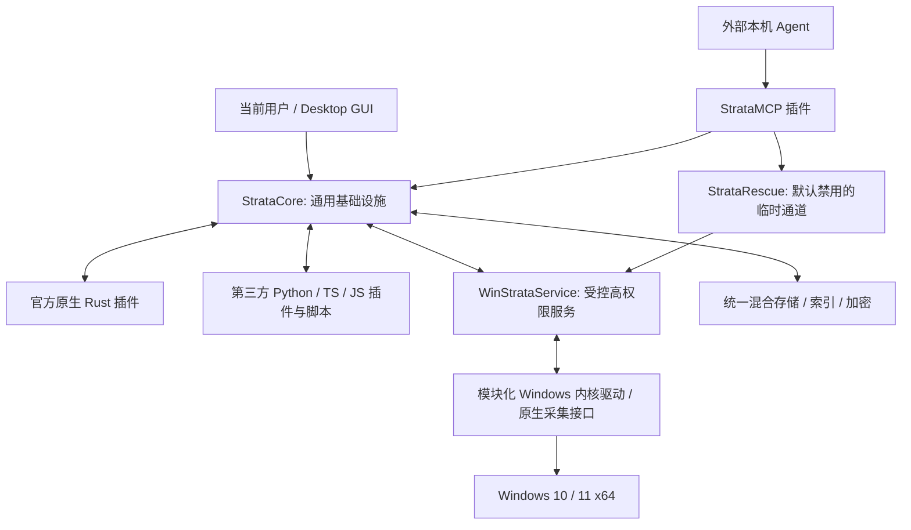

# 系统架构与工程布局

[English](../../architecture/SYSTEM.md) · [文档索引](../INDEX.md)

<a id="section-3"></a>

## 整体架构

### 3.1 微内核式应用架构



Core 不可卸载，仅承载通用基础设施：GUI 容器、插件市场及生命周期、能力注册、权限隔离、事件总线、内部 IPC、公共采集管理、统一存储/索引/配置/加密、任务调度、最低资源保护、故障记录、更新管理和全局设置。业务分析全部以插件提供。禁用所有业务插件时，Core 仍应独立稳定运行；不启动无订阅需求的采集和专属运行时。

GUI 与 Core 按普通用户权限运行，受控后台服务承担必要高权限，驱动在内核态运行。进程、服务和驱动之间通过版本化协议通信，进行身份/当前用户校验、参数验证、权限检查与审计。普通插件和脚本不得获得后台服务系统权限，不得直接访问驱动。官方插件遵守同一能力契约，特殊救援能力独立、显式、受限。

### 3.2 底层采集与驱动

混合采集、Windows 官方支持接口优先、最小化自研内核代码。候选接口包括 ETW、WFP、PDH、WMI/CIM、Windows API、USN Journal、Windows Event Log，以及必要时文件系统 minifilter、注册表、进程/线程/模块通知等官方机制。具体实现及外部项目必须调研、实测并审批。

多驱动设计，候选产物 `strata-fs.sys`、`strata-reg.sys`、`strata-proc.sys`、`strata-net.sys`；具体拆分取决于技术验证。驱动独立构建、版本、状态管理、按需加载、安全卸载；引用计数协调共享订阅。单驱动加载失败需明确受影响范围，无依赖模块继续工作。内核层只负责采集和传输，不执行业务分析；控制 IRQL、锁竞争、内存、缓冲、回调时长；不使用非标准 hook 或未验证接口，不绕过驱动签名、Secure Boot、HVCI 等安全机制。真实 Windows 稳定性、故障、卸载及长时间测试是完成条件。

### 3.3 统一事件和资源管理

- 事件统一类型、协议版本、来源标识、设备/用户/进程稳定标识、时间戳、顺序、观测精度、归因依据、完整性状态；事件序号与缺失区间可追溯。PID 重用、重启、时钟变化及多来源时间对齐应实际验证。
- 高频事件通过有界缓冲、批量传输、低拷贝、背压、按需订阅和去重；不重复采集。用户主动过滤、策略采样、异常丢失、暂停、故障分别标记；禁止静默丢失。避免无限等待、队列、线程池及运行时。
- Core 统一调度、任务优先级、取消、超时、资源预算执行；高吞吐场景可采用经验证的专用机制。不能阻塞 GUI 主线程。
- 多插件共享底层事件、统一对象标识及数据引用，不直接访问彼此私有实现/数据库。依赖通过能力声明、服务注册和事件协议；必要/可选依赖、版本、循环、禁用影响、降级、恢复和独立更新皆可验证。
- 全局搜索、关联查询和对象档案由 Core 通用索引支撑，业务关联视图由插件实现。原始事件、计算依据、推断可信度、采集覆盖状态必须可追溯。

### 3.4 技术栈与构建约束

已确认 Rust 核心 + Web 前端、混合运行时、Windows-only 产物和 Linux/Windows 开发能力。初步候选：Tauri、React、TypeScript、Vite、Cargo Workspace、pnpm Workspace、SQLite、Windows 原生 Rust 绑定、异步运行时、LLVM/LLD 等。此处不锁定具体版本或未经批准的第三方项目。

纯 Linux 应能够完整构建 Windows x64 项目，包括内核驱动、GUI、服务和开发交付产物，不以 Windows VM 或远程 Windows 构建节点代替 Linux 构建能力。Windows 运行、驱动签名/加载、HVCI 兼容和真实 GUI 验证与交叉编译是不同问题。驱动工具链、链接、INF/CAT、签名及正式安全机制下运行的可行性是早期高风险验证项；未验证前不得保证成功，也不得擅自放宽要求。开发 Agent 调研官方资料、候选开源项目及真实 PoC 后报告；如有矛盾，暂停受影响部分并申请批准。

**最新构建责任规则**：每个开发者负责当前可用环境的依赖、构建、测试和排错；不强制每个 PR 双端构建，也不强制使用云 VM。项目仍必须保留双环境构建能力，已确认的跨平台问题必须修复。未执行另一环境验证需记录；Linux 构建成功不得冒充 Windows 真实运行。需要真实 Windows 验收而环境缺失时，状态为待验证，不伪造通过；不受影响工作可以继续。

<a id="section-11"></a>

## 仓库目录与集中管理（提案）

```text
winstrata/
  AGENTS.md
  README.md
  README.zh-CN.md
  LICENSE
  NOTICE                       # 按实际义务维护
  CONTRIBUTING.md
  SECURITY.md
  Cargo.toml                   # Workspace 统一依赖声明
  Cargo.lock
  pnpm-workspace.yaml
  pnpm-lock.yaml
  apps/desktop/                # Tauri / Web GUI 容器
  core/                        # 公共基础设施；可按真实职责拆 crate
  kernel/                      # 模块化驱动及共享协议
  services/                    # 高权限后台服务
  plugins/                     # 25 个官方插件，各自独立生命周期
  sdk/                         # Python / TypeScript / JavaScript SDK
  runtimes/                    # 混合运行时、权限隔离、统一管理
  protocols/                   # IPC、事件、插件协议、版本与类型
  packages/                    # 共享前端组件及类型
  toolchains/                  # 项目级工具链声明及解析
  scripts/                     # 统一开发入口（具体工具待批准）
  tests/                       # 共享整体测试、真实场景与回归资产
  benchmarks/                  # 可复现性能基准
  docs/                        # 权威文档及索引，见 [§12](../standards/DOCUMENTATION.md#section-12)
  .github/                     # CI、PR 模板、贡献流程
```

此为逻辑目录，不要求 PR 000 创建全部空目录，也不强制用目录拆分数量体现模块化。业务插件子目录按实际需要建立，局部文档/AGENTS.md 仅补充专属要求。正式实现不得靠空壳/占位通过验收。目录变更须审批。

Rust 依赖由根 Workspace 统一版本声明，成员按需引用；前端由 pnpm Workspace 管理版本/锁定文件；Python SDK 和开发工具集中依赖规范；外部 SDK/WDK、编译器、运行时集中版本和路径解析。第三方插件隔离依赖环境由同一运行时管理，不在源码目录散落重复环境。配置分类集中，统一注册、校验、动态更新、迁移、敏感项安全存储；不在各模块随意读取环境变量或硬编码路径。检查实际解析路径指向项目级声明的依赖，不引用其他项目/临时目录；不因路径错而重新安装/复制。允许复用已有正确依赖/缓存，不每次重装，开始前必须补齐已批准依赖。外部系统工具链无需复制进仓库。

统一开发命令入口覆盖初始化、依赖检查、构建、运行、真实整体测试、代码/文档/安全/架构/顺序检查、性能及清理；Linux/Windows 尽可能同命令、参数、输出。具体工具经审批，避免每模块独立脚本。编译产物、缓存、测试数据、临时文件、系统监视数据、抓包、数据库、密钥及个人配置不提交；按需清理本次产生的无用文件，保留必要可复用依赖和证据，不无差别删除。
